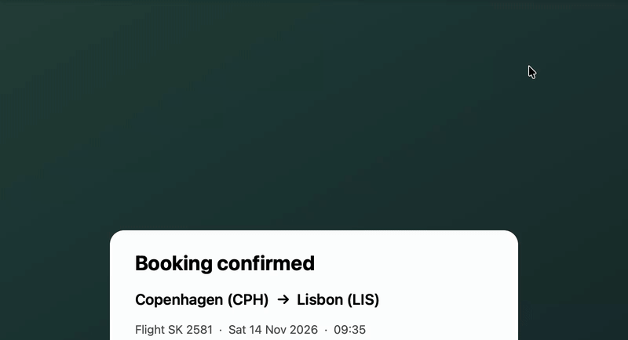
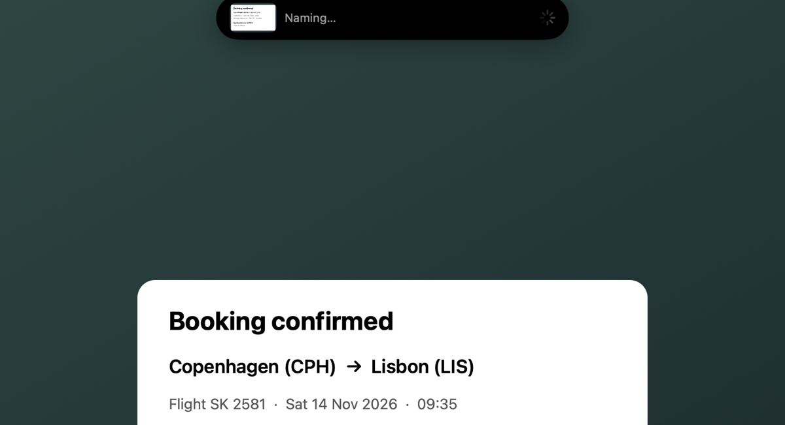
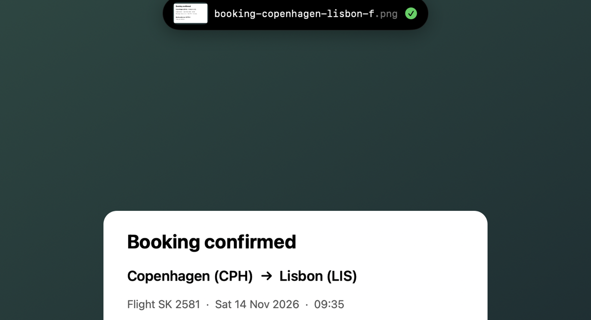

# Spruce

Spruce is a macOS menu bar app that watches for new screenshots, reads their text on-device, asks an AI model for a short description, and renames the file:

```
Screenshot 2026-11-02 at 12.34.56 PM.png  →  slack-message-from-alice-about-q3-budget.png
```



[Watch the demo video (MP4)](https://gvsh-png.github.io/spruce/media/demo.mp4)

| Reading the screenshot | Renamed |
|---|---|
|  |  |

Requires macOS 14 or later, Apple Silicon first. Apple's on-device model needs macOS 26 with Apple Intelligence turned on.

## Install

```sh
curl -fsSL https://gvsh-png.github.io/spruce/install.sh | bash
```

Installs the latest release into /Applications and opens it. Spruce then updates itself (Settings → General → Updates). Run the same command again to reinstall.

## Build and run

You need Xcode 26 (free, from the App Store) and XcodeGen.

```sh
brew install xcodegen
xcodegen generate
open ScreenshotRenamer.xcodeproj        # then Run (⌘R)
```

Or from the terminal:

```sh
xcodegen generate
xcodebuild -scheme ScreenshotRenamer -configuration Debug -derivedDataPath build build
open "build/Build/Products/Debug/Spruce.app"
```

If `xcode-select` still points at the Command Line Tools, prefix the commands with `DEVELOPER_DIR=/Applications/Xcode.app/Contents/Developer`.

The `.xcodeproj` is generated. Change targets, Info.plist keys and build settings in `project.yml`.

Run the self-check for the naming rules (Command Line Tools are enough):

```sh
swiftc Sources/TextRules.swift Tests/main.swift -o /tmp/selfcheck && /tmp/selfcheck
```

## Permissions

- **Folder access.** The app is not sandboxed. The first time it watches Desktop, Documents or Downloads, macOS asks once for access to that folder. Other folders, including the default `~/Pictures/Screenshots`, need no prompt. If you click Don't Allow, turn access back on in System Settings → Privacy & Security → Files and Folders. Full Disk Access is not needed.
- **Notifications.** The app asks once. Notifications carry an Undo button.
- **Keychain.** A cloud API key is saved in your login Keychain. Development builds are signed ad hoc, so macOS may ask for Keychain access again after each rebuild.

## How it works

The pipeline is one file per step:

| Step | File | What happens |
|---|---|---|
| Watch | `Sources/Watcher.swift` | A `DispatchSource` on each folder reports changes. New files are kept only when macOS marked them as screenshots (`kMDItemIsScreenCapture`, works in every system language) and they don't already carry our own "done" attribute. The app waits until the file stops growing, because macOS writes a hidden temp file first. |
| OCR | `Sources/OCR.swift` | Vision `VNRecognizeTextRequest`, accurate level, on-device. |
| Pick text | `Sources/TextRules.swift` | Drops low-confidence lines and duplicates, ranks the rest by text size and position, keeps about 1,500 characters. If fewer than 20 characters remain, a 512 px thumbnail is prepared. |
| Name | `Sources/Naming.swift` | Asks the model for 3–8 words as JSON. The prompt is versioned (`Prompt.version`), and the version is stored with each history entry. |
| Rename | `Sources/Storage.swift` | The app, not the model, builds the filename: case style, optional date, an 80-character limit, letters and digits only. Taken names get `-2`, `-3`. Files are never overwritten. |
| Log | `Sources/Storage.swift` | Each rename is appended to `~/Library/Application Support/ScreenshotRenamer/history.jsonl` and can be undone. |

`Sources/AppState.swift` runs the steps one file at a time from a queue, with OCR and network work off the main thread. `Sources/App.swift` holds the menu bar popover and the Settings window, `Sources/Panel.swift` the capture panel, and `Sources/Bulk.swift` the bulk rename window.

Files that are already in a folder when watching starts are left alone. To rename existing screenshots, use **Rename Old Screenshots…** in the menu.

`propose` (OCR + AI + naming rules) never touches the file; `apply` is the only step that renames it. The capture panel and bulk rename show the proposal first.

## AI providers

Set the provider in Settings → AI.

- **Automatic** (default): Apple's on-device model if available, then Ollama if it's running, then the cloud API, but only if you added a key. Nothing leaves your Mac unless you configured a cloud key.
- **Apple on-device**: macOS 26 with Apple Intelligence turned on. Text only. Free, nothing to install.
- **Ollama**: install it from ollama.com, then run `ollama pull gemma3:4b`. That model also reads images, which helps with screenshots that contain little text. Default server: `http://localhost:11434/v1`.
- **Cloud API**: any OpenAI-compatible endpoint. The default is Anthropic (`https://api.anthropic.com/v1`, model `claude-haiku-5-5`). For OpenAI, use `https://api.openai.com/v1` and a model such as `gpt-4o-mini`. Only the extracted text is sent. A small image is sent only if you turn on "Send a small image…".

If the model fails, network errors are retried twice (after 2 s, then 6 s). After that, the file is named after the app that was in front, plus the time, e.g. `xcode-2026-11-02-1234.png`.

## After a screenshot

- **Clipboard.** The image is copied as soon as macOS saves the file, so you can paste it right away.
- **Capture panel.** A small panel in the bottom-right corner shows the screenshot and its proposed name. Click the name to edit it and press Return. Copy, Copy Text, Move and Delete are one click each. The name is applied after 6 seconds without hovering or typing, or when you press Esc or close the panel. It never takes focus from the app you're working in. Turn it off in Settings → General to get a notification with Undo instead.
- **Faster saves.** Turn off Apple's floating thumbnail (⌘⇧5 → Options → Show Floating Thumbnail). macOS doesn't save the file until that thumbnail disappears, which adds 5–15 seconds.

## Private apps

Screenshots taken while a listed app is in front keep their original name, and nothing from them is read or sent to any AI. The defaults are 1Password, Bitwarden, Passwords, Keychain Access and Messages. Edit the list in Settings → Private Apps.

## Finder tags

Each renamed screenshot gets a Finder tag for its kind: Chat, Code, Receipt, Document, Design, Web, Email, Social, Video or Map. Filter by a tag in any Finder sidebar. Turn tags off in Settings → Sorting.

## Rename old screenshots

Menu bar → **Rename Old Screenshots…** scans your screenshot folder for files that still have their system name ("Screenshot 2026-10-30 at 14.09.49", in any language). It proposes a name for each, and you can edit or untick any before applying. The whole batch is one step for **Undo Last**.

## Folder sorting

Off by default. Turn it on in Settings → Sorting and list your folders (e.g. `Receipts`, `Work/Slack`). The model picks one of them or none, and it never creates new folder names. Folders are created inside the folder the screenshot was saved in.

## Distribution notes

v1 targets a direct download, signed with Developer ID and notarized, not the Mac App Store. A sandboxed App Store build would need security-scoped bookmarks for every watched folder. The planned model is a one-time purchase: local AI is free, and the cloud uses your own key, so no backend is needed.

## Known limits

- Settings reset to defaults if the settings format changes between versions.
- The fallback name uses the frontmost app at detection time, about a second after capture.
- Third-party screenshot tools (CleanShot, Shottr) don't set the macOS screenshot flag. Turn on "Also rename files whose names start with…" in Settings → General to catch them.

---

© 2026 gvsh-png. All rights reserved.
