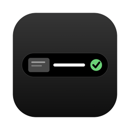
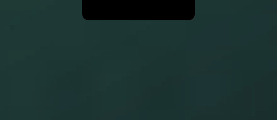
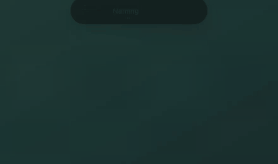
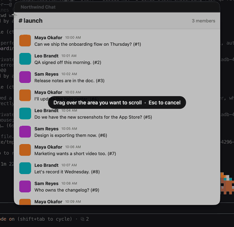
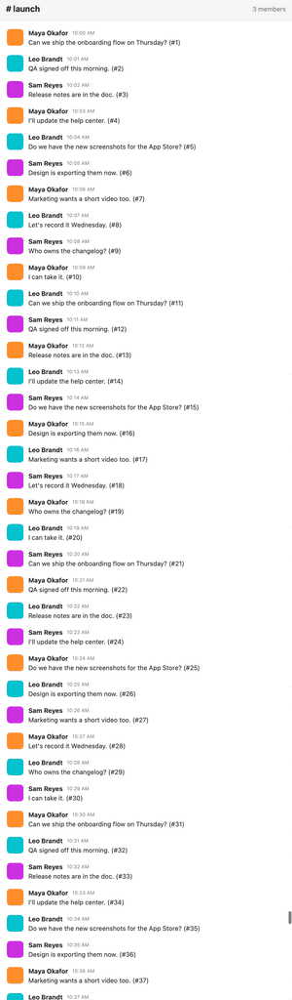
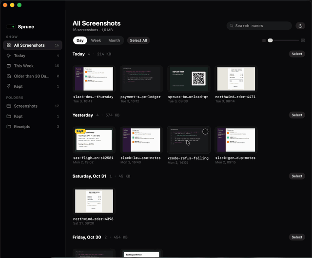

<div align="center">



# Spruce

**Your screenshots, named for you.**

Spruce reads each new screenshot on your Mac and gives it a real name, so<br>
`Screenshot 2026-11-03 at 10.12.00.png` becomes `booking-copenhagen-lisbon-flight-sk-2581.png`.

[](https://github.com/gvsh-png/spruce/releases/latest)
[](#requirements)
[](#requirements)
[](#privacy)
[](https://github.com/gvsh-png/spruce/releases)

[Install](#install) · [Features](#features) · [Privacy](#privacy) · [AI models](#ai-models) · [FAQ](#faq)

<br>


<sub>Take a screenshot. A small pill drops in, reads it, and names it. <a href="https://gvsh-png.github.io/spruce/media/demo.mp4">Watch in full quality</a>.</sub>

</div>

## Install

Paste this into Terminal:

```sh
curl -fsSL https://gvsh-png.github.io/spruce/install.sh | bash
```

Spruce installs into `/Applications`, opens, and lives in your menu bar. From then on it updates itself.

## Features

<table>
<tr>
<td width="50%" valign="top">

<b>Names it while you watch</b><br>
<sub>Text is read on your Mac, then a model writes the name. Click it to change it.</sub>
</td>
<td width="50%" valign="top">

<b>Everything one hover away</b><br>
<sub>Keep, Copy, Copy Text, Move to a folder, or Delete.</sub>
</td>
</tr>
<tr>
<td valign="top">

<b>Peek</b><br>
<sub>Rest on the thumbnail for a bigger look. Drag it straight into Slack or Mail.</sub>
</td>
<td valign="top">

<b>Delete without worry</b><br>
<sub>Goes to the Trash, with Undo right there.</sub>
</td>
</tr>
<tr>
<td valign="top">

<b>QR codes open in one click</b><br>
<sub>Links open in your browser. Anything else, like Wi-Fi details, is copied.</sub>
</td>
<td valign="top">

<b>No piles of duplicates</b><br>
<sub>Took the same shot twice? The older one goes to the Trash. Click "−1 similar" to bring it back.</sub>
</td>
</tr>
<tr>
<td colspan="2" valign="top">
<table><tr>
<td width="68%" valign="top"></td>
<td width="32%" valign="top"></td>
</tr></table>
<b>Scroll capture</b> · <kbd>⌥</kbd><kbd>⇧</kbd><kbd>⌘</kbd><kbd>4</kbd><br>
<sub>Drag over a chat or a page, scroll, press Done. One tall screenshot, named like any other. Sticky headers show up once.</sub>
</td>
</tr>
<tr>
<td colspan="2" valign="top">

<b>Screenshot Manager</b><br>
<sub>Every screenshot by day, week or month. Select a whole week, delete it, change your mind.</sub>
</td>
</tr>
</table>

**Also in the box**

- Copies each screenshot to the clipboard the moment it's saved
- Screenshots go to the Trash after 14 days unless you keep, move or sort them
- Private apps: shots of 1Password, Messages and anything you add keep their name and are never read
- Finder tags by kind (Chat, Code, Receipt, Document, …) and optional sorting into your folders
- Rename the screenshots you already have, all at once, as one Undo
- Full rename history, every step undoable

## Privacy

- **On your Mac by default.** Text is read with Apple's Vision framework, and names come from Apple's on-device model or a local Ollama model. Nothing leaves your Mac unless you add a cloud API key yourself.
- **Text only.** With a cloud model, only the extracted text is sent. A small image is sent only if you turn that on.
- **No account, no analytics, no server.** Settings stay on your Mac. A cloud API key is stored in your Keychain.

## AI models

Pick one in **Settings → AI**. **Automatic** uses the first that works:

| Model | What you need | Cost |
|---|---|---|
| **Apple on-device** | macOS 26 with Apple Intelligence turned on | Free |
| **Ollama** | [ollama.com](https://ollama.com), then `ollama pull gemma3:4b` | Free |
| **Cloud API** | Any OpenAI-compatible API and your own key (Anthropic, OpenAI, …) | Your API usage |

If no model answers, the file is named after the app you were using plus the time, e.g. `xcode-2026-11-02-1234.png`.

## Requirements

- macOS 14 Sonoma or later. Apple's on-device model needs macOS 26.
- Built for Apple Silicon.

## FAQ

<details>
<summary><b>Renaming takes a few seconds before anything happens</b></summary>
<br>
macOS doesn't save a screenshot until its floating thumbnail goes away. Turn the thumbnail off: press ⌘⇧5, open Options, and untick Show Floating Thumbnail. Spruce's pill does the same job.
</details>

<details>
<summary><b>Does it work with CleanShot, Shottr and other screenshot apps?</b></summary>
<br>
Yes. Turn on <b>Settings → General → Also match by filename</b>. Those apps don't mark their files as screenshots the way macOS does.
</details>

<details>
<summary><b>Scroll capture asks for Screen Recording</b></summary>
<br>
It needs to see the area you pick while you scroll. Turn Spruce on in System Settings → Privacy & Security → Screen & System Audio Recording. Spruce only captures that area, only while the capture runs, and never records video or sound. macOS may also ask once to let Spruce "bypass the private window picker"; choose Allow.
</details>

<details>
<summary><b>What about screenshots I already have?</b></summary>
<br>
Choose <b>Rename Old Screenshots…</b> in the menu bar. You'll see every proposed name first and can edit or skip any of them. The whole batch is one Undo.
</details>

<details>
<summary><b>macOS says Spruce can't be opened</b></summary>
<br>
Spruce isn't notarized by Apple yet. The Terminal install above avoids this. If you downloaded the zip in a browser, open System Settings → Privacy & Security and click <b>Open Anyway</b> next to Spruce.
</details>

<details>
<summary><b>How do I uninstall it?</b></summary>
<br>
Quit Spruce from the menu bar and move <code>/Applications/Spruce.app</code> to the Trash. Your history is in <code>~/Library/Application Support/ScreenshotRenamer</code>.
</details>

## Building from source

<details>
<summary>Build, test and release</summary>

You need Xcode 26 and [XcodeGen](https://github.com/yonaskolb/XcodeGen).

```sh
brew install xcodegen
xcodegen generate
open ScreenshotRenamer.xcodeproj        # then Run (⌘R)
```

Or from Terminal:

```sh
xcodegen generate
xcodebuild -scheme ScreenshotRenamer -configuration Debug -derivedDataPath build build
open build/Build/Products/Debug/Spruce.app
```

If `xcode-select` points at the Command Line Tools, prefix commands with `DEVELOPER_DIR=/Applications/Xcode.app/Contents/Developer`. The `.xcodeproj` is generated: change targets, Info.plist keys and build settings in `project.yml`.

Self-check for the naming rules:

```sh
swiftc Sources/TextRules.swift Sources/Stitch.swift Tests/main.swift -o /tmp/selfcheck && /tmp/selfcheck
```

Ship a release (builds, signs the update, updates the feed, publishes on GitHub):

```sh
scripts/release.sh 0.2.0 "What changed"
```

</details>

<details>
<summary>How it works</summary>

| Step | File | What happens |
|---|---|---|
| Watch | `Sources/Watcher.swift` | Watches each folder for files macOS marked as screenshots (`kMDItemIsScreenCapture`, works in every language). |
| Read | `Sources/OCR.swift` | Apple Vision text recognition, on-device. |
| Pick text | `Sources/TextRules.swift` | Drops low-confidence lines and duplicates, ranks the rest by size and position, keeps about 1,500 characters. |
| Name | `Sources/Naming.swift` | Asks the model for a few words, a kind and an optional folder, streamed so the pill can show the name as it's written. |
| Rename | `Sources/Storage.swift` | Spruce, not the model, builds the filename: style, optional date, length limit, safe characters. Existing files are never overwritten. |
| Log | `Sources/Storage.swift` | Each rename is appended to `history.jsonl` and can be undone. |

`Sources/AppState.swift` runs the steps one screenshot at a time. `Sources/Panel.swift` is the pill, `Sources/Manager.swift` the Screenshot Manager, `Sources/Bulk.swift` bulk renaming, and `Sources/Updater.swift` auto-updates (Sparkle, signed with EdDSA).

</details>

---

<div align="center">
<sub>© 2026 gvsh-png. All rights reserved.</sub>
</div>
