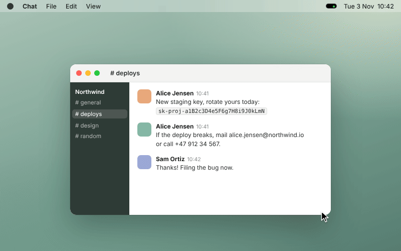
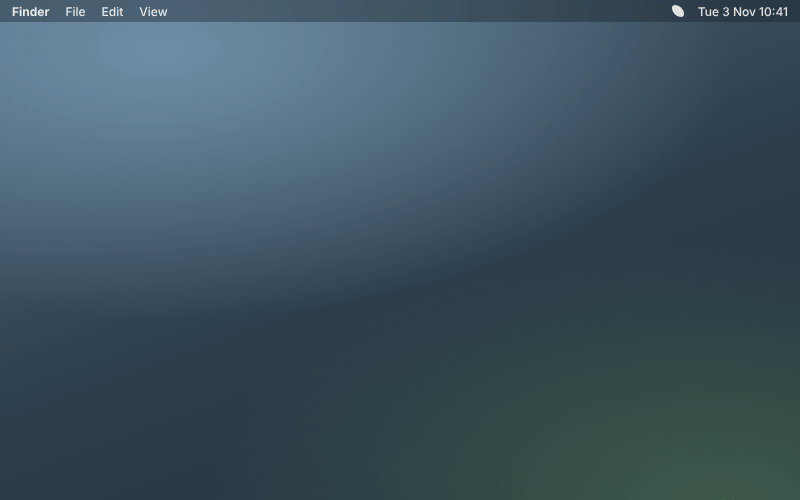
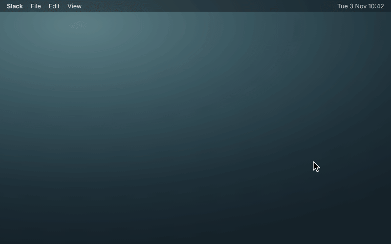
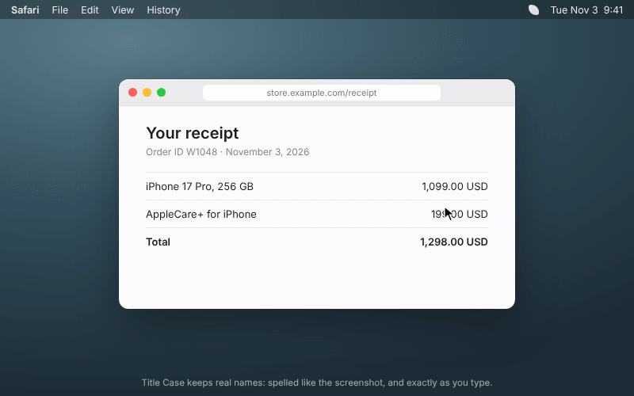

# Handoff: four new Spruce features

This branch adds four features to Spruce. Another agent (Claude Code) wrote them on Linux, where there is no Swift compiler. **No part of this code was built or run.** Use this file to build the features, fix them, test them and record real GIFs.

## Your task (for the AI that reads this)

1. Build the app: `xcodegen generate`, then `xcodebuild -scheme ScreenshotRenamer -configuration Debug -derivedDataPath build build`. Fix all compile errors. Keep each fix small, and keep the features as described below.
2. Run the self-check: `swiftc Sources/TextRules.swift Sources/Stitch.swift Tests/main.swift -o /tmp/selfcheck && /tmp/selfcheck`. All checks must pass. Fix the code, not the tests, unless a test is clearly wrong.
3. Open `build/Build/Products/Debug/Spruce.app` and test each feature by hand with the steps in "How to test" below. Read the "Risks" for each feature, because they show what to look at first.
4. Record a real GIF of each feature, in the same style as the GIFs that are in `docs/media/` now (800 px wide, loops forever, short). Save them as `docs/media/redact.gif`, `docs/media/search.gif`, `docs/media/copy-name.gif` and `docs/media/title-case.gif`. The mockups in `handoff/media/` show what each GIF must show. They are HTML animations, not the real app.
5. Add the features to the Features table in `README.md`, in the same short style.
6. When everything works, delete the `handoff/` folder.

## How the branch is made

The base is `dd433e9` (Release 0.1.6). Each feature was made on its own branch, and then the four branches were merged in this order:

1. `idea/045-copy-carries-the-name`
2. `idea/042-faithful-title-case`
3. `idea/023-search-inside-highlight`
4. `idea/071-one-click-auto-redact`. This merge had a conflict in the `Proposal` struct. The fix keeps both `lines` and `sensitive`.

**A fix that was made during the merge:** Search saves the OCR text in the extended attribute `com.screenshotrenamer.text`, and Redact copies every extended attribute to the redacted file. So a redacted file would still have the hidden secrets as text. Now `Redactor.copyAttributes` does not copy that attribute. After a redact, `capture.proposal.lines` is cleared, and `apply` only saves text when there are lines. Search then reads the redacted image again later. **Test this:** redact a screenshot, then run `xattr -l` on the file. The secret must not be in the output.

The four features change some of the same files: `AppState.swift`, `TextRules.swift`, `Panel.swift` and `Tests/main.swift`. Check that they work together. For example, Copy after Redact must paste the redacted file with its name.

How the features were chosen: 100 agents each proposed one idea. 56 ideas were duplicates. 16 ideas were built, and judges compared the real diffs in head-to-head matches. These four were ranked 1st, 2nd, 4th and 5th.

---

## One-click auto redact

Mockup: [`media/1-one-click-auto-redact.gif`](media/1-one-click-auto-redact.gif). This is an animation, not the real app. The source is `media/071-one-click-auto-redact-demo.html`.

**What it does:** When a new screenshot contains something sensitive (email address, phone number, card number, API key or token, IBAN), the pill shows a quiet "Redact 3" button next to Copy. One click blacks out exactly those words, in place, using the text positions Vision already found. The cleaned image goes straight to the clipboard, ready to paste into Slack or a bug report, and Undo brings back the original. CleanShot X and Shottr make you draw blur boxes by hand. Spruce already knows where every word is, so it can do this with no editor and nothing leaving the Mac.

**What was built:** I added one-click Redact to the pill. While OCR runs, a new pure function, TextRules.sensitiveRanges, looks for email addresses, phone numbers (international or North American format), card numbers that pass the Luhn check, IBANs that pass the mod-97 check, known key and token formats (sk-, sk_live_, ghp_/github_pat_, xox*, AKIA/ASIA, AIza, glpat-, JWT) and other long random-looking strings. OCR.read then uses VNRecognizedText.boundingBox(for:) to get a box around just the matching characters, and the boxes are stored in Proposal.sensitive. When there are matches, the pill grows from 360 to 412 pt wide and shows "Redact N" after Copy Text. Clicking it runs the new Redactor (Sources/Redact.swift) off the main thread. It covers each box with a dark rounded fill, or pixelates it if that style is chosen. The file keeps its format and its image properties (such as DPI) and gets its extended attributes copied over. The redacted copy is written to a hidden temp file, the original goes to the Trash, and the copy is renamed into the original's place. The redacted image is then copied to the clipboard, the thumbnail and Peek refresh, Copy changes to "Copied" and the button changes to "Redacted". Clicking "Redacted" brings the original back from the Trash. Settings → Island gets a "Sensitive text" section with "Offer to redact sensitive text" (on by default) and a Solid/Pixelate picker. Tests/main.swift has new self-checks for each detector, and for no false positives on dates, version numbers, amounts, git hashes and slugs. I checked those expected results with a Python copy of the same regexes and checks, but the Swift self-check itself has not been run.

**Files changed:** `Sources/TextRules.swift`, `Sources/OCR.swift`, `Sources/Redact.swift`, `Sources/AppState.swift`, `Sources/Panel.swift`, `Sources/Storage.swift`, `Sources/App.swift`, `Tests/main.swift`, `README.md`

**Original branch:** `idea/071-one-click-auto-redact` (commit `c46a926`). This branch is only in the cloud session and was not pushed. The same code is in this branch's merge commits.

**How to test:** Take a screenshot of text that contains an email address, a phone number and a fake key such as `sk-test1234567890abcdefghijklmnop`. The pill must show "Redact 3". Click it. The thumbnail shows black boxes over only those words, and the clipboard has the redacted image. Click "Redacted" to undo: the original comes back. Also check that a date, an amount such as `$12.50` and a git hash do not trigger "Redact". Then turn off Settings → Island → "Offer to redact sensitive text" and check that the button no longer appears.

**Risks reported by the agent that wrote it:** Nothing has been compiled. The main compile risks: (1) `(try? candidate.boundingBox(for: range))?.boundingBox` assumes Swift 5 flattens the optional that try? produces; it does, but it is worth checking. (2) `guard let capture` inside the Task in redactCapture shadows self.capture through implicit self; that code uses `self.capture?` explicitly afterwards on purpose. (3) The listxattr/getxattr/setxattr pointer conversions in Redactor.copyAttributes. (4) The static `sensitivePatterns` array of (NSRegularExpression, closure) tuples may give Sendable warnings, not errors, under SWIFT_VERSION 5. I verified the detection logic only with a Python version of the same regexes and checks. ICU regex should behave the same for these patterns, but the Swift self-check (swiftc Sources/TextRules.swift Sources/Stitch.swift Tests/main.swift) still needs to be run on a Mac. Behaviour risks: the box Vision gives for part of a line can be loose or slightly off, so the code pads boxes by about 12% of their height and falls back to covering the whole line. Pixelate is weaker than Solid (blocks are about 0.6 of the text height), which is why Solid is the default. Phone detection only matches numbers with a leading + or the North American format, so local formats like 0123456789 are missed on purpose to avoid false positives on dates and IDs. The general random-token rule could occasionally flag long mixed-case identifiers. Redact overwrites the file in place: undo works through the Trash, and if the user empties the Trash first, the original is gone. The tools row width at 412 pt is estimated from font metrics, not measured in SwiftUI; if the labels come out wider, Delete may be squeezed. The demo is a hand-built HTML mock that follows Panel.swift's sizes and colors, not a capture of the real app.

---

## Search inside screenshots, words highlighted

Mockup: [`media/2-search-inside-highlight.gif`](media/2-search-inside-highlight.gif). This is an animation, not the real app. The source is `media/023-search-inside-highlight-demo.html`.

**What it does:** Today the Screenshot Manager only searches filenames ("Search names"). With this change you type "wifi", "invoice 4471" or a friend's name, and the Manager finds every screenshot that has those words anywhere in it, even ones the name never mentions. Each match shows a soft green highlight over the exact words on its thumbnail, with a one-line snippet under the name. That moment of "it found the password I screenshotted three weeks ago and pointed right at it" is the one people show friends. Text stays on the Mac, saved next to the file, and no index server or network is involved.

**What was built:** The Screenshot Manager can now search the text inside screenshots as well as their names. Spruce already runs OCR on every screenshot to name it. The lines it reads, with their positions, are now saved next to the file in a `com.screenshotrenamer.text` extended attribute (compact JSON, confidence of at least 0.4, capped at 32 KB), written in `AppState.apply()` right after `markDone`. Because it is an extended attribute, the text follows the file through renames and moves. A screenshot matches when every word you type appears in its name or its text, ignoring case, accents and width. Matching words get a soft green highlight (Theme.success at 0.35, fading in) on the fitted thumbnail, and the matching line replaces the date under the name. The search field now says "Search names and text". Screenshots Spruce named before this change are read in the background one at a time at .utility priority the first time you search, and the header subtitle shows "Reading N older screenshots…" while that runs. The matching rules (storedLines, encodeStored and decodeStored, fold, searchTokens, search, subBox, snippet) live in TextRules.swift, with new checks in Tests/main.swift.

**Files changed:** `Sources/TextRules.swift`, `Sources/Watcher.swift`, `Sources/AppState.swift`, `Sources/Manager.swift`, `Tests/main.swift`

**Original branch:** `idea/023-search-inside-highlight` (commit `0ebdd09`). This branch is only in the cloud session and was not pushed. The same code is in this branch's merge commits.

**How to test:** Take a screenshot of text that contains the word "invoice", but where the name does not include it. Open the Screenshot Manager and search "invoice". The screenshot must appear, with a green highlight over the word and a snippet under the name. With older screenshots, the header must show "Reading N older screenshots…" until they are all read.

**Risks reported by the agent that wrote it:** Nothing was compiled or tested, and the new checks in Tests/main.swift have not been run, because this container has no Swift. I checked the APIs by hand, but things like the `Text(String + ternary)` expression in the header and the `while ..., let range = line.range(of:range:)` loop could still need small fixes. Highlights are approximate: only whole-line boxes are saved, so a word's position is estimated by assuming every character is the same width, which can be off by a character or two in proportional fonts. Matching is plain substring: "wifi" does not match "Wi-Fi", and a one-letter search matches a lot. The background reading only runs on files Spruce already handled (done xattr), so private-app shots are never read; old screenshots that still have their system name (never handled) can be found by name only until Bulk Rename processes them. The first search with a large existing library starts a long sequential OCR pass (100–800 ms per file) that keeps going after the search is cleared and stops only when the window closes. Each file is tried once per Manager session, and the list refreshes every 8 files. reload() now reads up to 32 KB of xattr per file on every refresh, and ShotFile's synthesized Hashable now hashes the text too; both could slow down very large libraries. Text that was copied or AirDropped elsewhere still carries the xattr, which keeps screenshot text on disk longer than before (it lives on the file only, nothing is sent over the network). The demo animation was only checked with headless Chromium screenshots, at 1 s and 6.5 s.

---

## Copy pastes the named file

Mockup: [`media/4-copy-carries-the-name.gif`](media/4-copy-carries-the-name.gif). This is an animation, not the real app. The source is `media/045-copy-carries-the-name-demo.html`.

**What it does:** Right now, when you press Copy in the pill (or rely on auto-copy) and paste into Slack, Mail, Finder or Messages, you get raw image bytes. They arrive as "image.png" or can't be pasted at all, so the name Spruce just made is lost at the exact moment you share the file. With this change, Copy first applies the name the same way dragging the thumbnail already does, then puts both the PNG and the renamed file's URL on the clipboard. Image editors still paste pixels, while Finder, Mail and chat apps paste "stripe-invoice-march.png". It also fixes a bug where pressing Copy after dragging the thumbnail out says "Copied" but copies nothing.

**What was built:** Pressing Copy in the pill now applies the name first, the same way dragging the thumbnail already does (it calls state.applyCaptureNow). The renamed file's URL then goes on the clipboard next to the PNG/TIFF data, so Finder, Mail and chat apps paste "stripe-invoice-march.png" and image editors still paste pixels. AppState.copyToClipboard now returns Bool (@discardableResult), and the pill only shows "Copied" when something was actually copied. This fixes the bug where Copy after a drag-out read the old, missing path. Auto-copy on arrival records the clipboard changeCount. When the live rename lands in apply(_:) and nothing else has been copied since, it copies again from the new path. Manager and history Copy get the file URL through the shared helper. I also removed the "already applied, return early" guard in finishCapture. A capture applied early by Copy or drag now re-applies from appliedURL, so a later Move, Keep or edited name still takes effect. When nothing changed, this is a no-op.

**Files changed:** `Sources/AppState.swift`, `Sources/Panel.swift`

**Original branch:** `idea/045-copy-carries-the-name` (commit `2a451d7`). This branch is only in the cloud session and was not pushed. The same code is in this branch's merge commits.

**How to test:** Take a screenshot and wait until it is named. Click Copy, then paste in Finder: you must get a file with Spruce's name. Paste in Preview or another image editor: you must get the pixels. Paste in Slack or Mail: you must get the named file. Also drag the thumbnail out, then click Copy: it must copy and show "Copied".

**Risks reported by the agent that wrote it:** Nothing was compiled; there is no Swift toolchain here. APIs used: NSPasteboardItem.setString(_:forType:) with .fileURL, NSPasteboard.changeCount and writeObjects returning Bool. All exist on macOS 10.13+. The existing single-expression Button closures in App.swift:73 and Manager.swift:256 now call a function that returns a discardable Bool. Swift accepts this in a () -> Void context, but I have not checked it with a compiler. Behaviour risks: (1) Copy now renames the file on disk before the pill times out, as drag already did. If the user later edits the name or picks Move or Keep, finishCapture does a second apply from appliedURL. That writes a second history entry, so Undo only reverses the last step. The second apply runs with live=false, so there is no extra haptic or rename count. This also changes drag-then-Move, which previously ignored the Move. (2) Which representation an app prefers when both the PNG data and the file URL are on the clipboard varies. Slack, Mail and Finder should take the file, but some apps may now paste a file attachment where they used to paste an inline image, and I have not checked this on a device. (3) The auto-copy refresh reads the file a second time (a few MB) after the rename. It only runs when changeCount is unchanged, so it can't overwrite the user's own copy. However, any app that writes to the pasteboard in between (clipboard managers usually only read) will cancel the refresh. (4) The file URL points at a path that can later move, for example after auto-trash or a manual move. Pasting long after copying will then give a stale file reference, though the image data still pastes.

---

## Title Case that keeps real names

Mockup: [`media/5-faithful-title-case.gif`](media/5-faithful-title-case.gif). This is an animation, not the real app. The source is `media/042-faithful-title-case-demo.html`.

**What it does:** Title Case names currently come out as "Github Pr Review", "Iphone Pdf Receipt Usd" and "Macos Xcode Build Id", and the same thing happens to names the user types in the pill: typing "iPhone 17 Pro" saves "Iphone 17 Pro". The same code path also turns the optional date prefix into "2026 11 03 Receipt" (or "2026_11_03_receipt" in snake_case), even though Settings previews "2026-11-03 Receipt". The fix: Spruce takes each word's spelling from the screenshot's own OCR text (GitHub, iPhone, PDF, USD), leaves what the user typed exactly as typed, and keeps the date intact. Names stop looking machine-mangled, and none of this touches the model, so it stays on-device.

**What was built:** I added `casingSource` to TextRules.stem. In Title Case it looks each word up in the screenshot's OCR text (`knownSpellings`), so "github" becomes "GitHub", "iphone" becomes "iPhone", and "pdf" and "usd" become "PDF" and "USD". It also keeps words that already have their own casing (macOS, ID). It skips shouted all-caps headings, and it drops a spelling when the same word also appears plainly capitalized (e.g. "Id"). A lowercase sighting such as "github.com" in a URL bar does not override a spelling. I also added `TextRules.normalizeEdited`, which `AppState.apply` now uses instead of re-running hand-edited names through stem(). It makes names safe but keeps what the user typed (so "iPhone 17 Pro" stays) and keeps a leading yyyy-MM-dd date as is, so names now match the Settings preview ("2026-11-03 Slack Alice", "2026-11-03_slack_alice"). The name streamed while the model is still writing now uses the same OCR casing, so it no longer changes from "Github" to "GitHub" when the final name arrives. The filter rules and the join/truncate code were split into private helpers without changing their behaviour. I added 16 checks to Tests/main.swift; nothing was compiled or run here. The demo shows a receipt screenshot named "2026-11-03 iPhone 17 Pro Receipt", which the user edits to "...AppleCare". It then shows the saved file, with the old struck-through "2026 11 03 Iphone 17 Pro Applecare.png" underneath.

**Files changed:** `Sources/TextRules.swift`, `Sources/AppState.swift`, `Tests/main.swift`

**Original branch:** `idea/042-faithful-title-case` (commit `6b1b040`). This branch is only in the cloud session and was not pushed. The same code is in this branch's merge commits.

**How to test:** Set the name style to Title Case and turn on "Include date". Take a screenshot of text that says "GitHub", "iPhone" and "PDF". The name must spell those words the same way. Edit the name in the pill to "iPhone 17 Pro AppleCare": it must save exactly as typed. The date prefix must be `2026-11-03`, not `2026 11 03`. Repeat with snake_case: the date must stay `2026-11-03`.

**Risks reported by the agent that wrote it:** There was no Swift compiler here, so none of this was built or run, including the new tests. Compile risks: (1) In propose, the closure that wraps onPartial has an explicit type annotation, `(([String]) -> Void)?`. It captures the local prefs/text and is called from the Apple model's stream. That is the same isolation pattern as the old closure in drain, but under strict concurrency it could produce warnings. (2) The date regex uses an ICU negative lookahead, `(?!\d)`, via String.range(of:options:.regularExpression). It should work on macOS 14. Behaviour risks: (a) In Title Case, a hand-edited name is no longer re-cased at all, so a lowercase edit like "my notes" is saved as typed. Bulk-rename edits also go through apply and behave the same way. (b) Any 2-4 letter all-caps word from the model, or from a non-shouted OCR line, is kept as an acronym ("TODO", "SALE" on a mixed-case line). Five letters or more are recapitalized, which keeps the existing "ALICE" -> "Alice" test passing. (c) The OCR spelling map is built from rankedText (at most 1500 characters), so a brand that appears only in OCR text that didn't make that cut is not recognized. (d) The streamed name and the final name now use the same OCR text, but the streamed name still has no date prefix, as before. The Settings example in App.swift is unchanged and was already correct.
